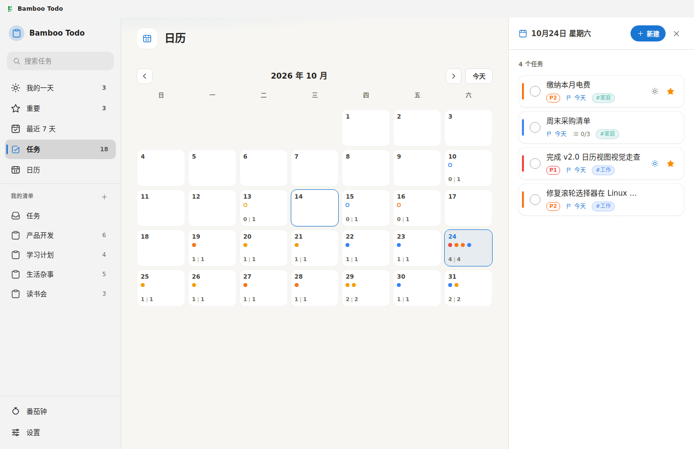

# Bamboo Todo

竹先花数年扎根，破土后一日一节，长成的高度皆由节的累积支撑。Bamboo Todo 以此为设计理念：数据离线存于本地，如根扎土；每完成一个任务便是一枚竹节，是留下的刻度，也是下一段生长的支点。列表不是催促的清单，而是一根正在生长的竹子——节积而后成高，日拱而不促其猛长。



## 功能特性

### 核心功能
- **三栏布局**：pill 式侧边栏 + 主列表 + 右侧固定宽度详情面板；未选中任务时显示占位提示（"点击任务标题显示详情"），选中任务不改变主视图宽度
- **Unibody 窗口**：无系统标题栏，自绘 Fluent 风格标题栏，窗口控制按钮由系统原生覆盖层（WCO）提供（设计方案见 `docs/unibody-design.md`）
- **智能清单**：
  - 我的一天 - 每日重点任务（含智能建议）
  - 重要 - 星标任务汇总
  - 最近 7 天 - 按天分组的截止视图
  - 日历 - 月历视图：点状紧凑日格（每格最多 10 个优先级色点，实心=待办、空心=已完成），底部显示 `待办|总数` 计数；点击日期在右侧 day sheet 查看当天任务清单，可直接新建任务、一键回到今天
  - 任务 - 所有任务
- **番茄钟**：侧边栏底部按钮切换，右下角浮动面板（任意视图可用），环形进度显示，时长可在设置中调整（默认 25/5 分钟）
- **自定义清单**：创建、重命名、删除
- **任务管理**：
  - 添加/编辑/删除任务（删除走应用内确认对话框，替代浏览器 `prompt/confirm`）
  - 完成任务（详情页底部「完成任务」按钮 / 列表复选框，自动折叠到已完成区域）
  - 重要标记（星标）
  - 添加到我的一天
  - 截止日期与提醒：统一 DateTimePicker（今天/明天/下周一/清除快捷 chip + 月历网格 + iPhone 滚轮式时间选择）
  - 重复任务（每天/工作日/每周/每月/每年），提醒随重复任务滚动到下一次发生日
  - 子任务（步骤）及进度条，支持拖拽排序（含拖到列表末尾）
  - 任务备注
  - 拖拽排序（自动切换为手动排序）
  - 优先级 P1-P4 与标签
- **搜索与筛选**：全局搜索，支持按优先级、标签筛选（在所有视图生效）
- **系统通知**：任务到期或提醒到点时推送系统通知，错过的提醒补发一次；可在设置中分别开关"到期通知""提醒通知"并测试发送。跨平台适配：Windows 归属 AppUserModelId、macOS 首次请求授权、Linux 依赖桌面通知服务与应用图标
- **本地 SQLite 存储**：任务/清单/标签/主题/设置持久化到 `bamboo.db`（better-sqlite3，WAL 模式）；首次启动自动将旧版 JSON 数据迁移入库并归档到 `data/legacy/`；帮助菜单可"导出数据库为 JSON"用于降级回旧版
- **可选更新检查**：默认启动时查询 GitHub Releases，可在设置中关闭

### 快捷键

应用内（Ctrl 为主键，mac 上为 Cmd）：

| 分组 | 快捷键 |
|------|--------|
| 常用 | `Ctrl+F` 搜索 · `Ctrl+N` 新建任务 · `Ctrl+,` 设置 · `F11` 全屏 |
| 任务 | `Ctrl+D` 删除 · `Ctrl+T` 重命名 · `Ctrl+Shift+N` 完成 · `Ctrl+Shift+H` 折叠已完成 · `Ctrl+Shift+T` 截止日 · `Ctrl+Shift+E` 提醒 · `Ctrl+K` 加到我的一天 · `Ctrl+I` 标记重要 |
| 导航 | `Ctrl+Shift+M/I/A` 跳转 我的一天/重要/任务 · `Ctrl+L` 新建清单 · `Ctrl+Shift+D/Y` 删除/重命名清单 · `Ctrl+1–9` 跳转清单 · `Ctrl+Tab / Ctrl+Shift+Tab` 切换清单 |
| 窗口 | `Ctrl+0/-/+` 缩放 · `Ctrl+Shift+J` 紧凑模式 · `Ctrl+Shift+O` 窗口置顶 |

全局（系统级，窗口隐藏时也可用）：`Ctrl+Alt+C` 弹出新建任务 · `Ctrl+Alt+F` 弹出搜索 · `Ctrl+Alt+A` 显示/隐藏窗口

### 主题系统
- 有机极简（Organic Minimalist / Nordic·Morandi）设计风格：大圆角、柔和弥散阴影、1px 微光描边替代硬边框、暖色中性面、统一 Feather/Lucide 线性图标（`src/js/icons.js`，`stroke=currentColor` 随主题自动取色）
- 主题令牌分层：品牌/状态色由 `Theme.js` 注入，中性面（背景/边框/文字）可由每个主题的 `colors.surfaces` 覆盖，缺省回退 `:root` / `html.dark-mode`
- 内置两套主题（默认 Passion）：
  - Passion（浅色 UI + Material 状态色）：进行中 `#4285F4`、处理中 `#FFCA28`、已完成 `#4DB6AC`、已取消 `#EF5350`
  - Passion 深色：深色表面 + 上述 Passion 状态色，也是自动夜间的联动变体（鼠尾草色调深色表面即此主题的呈现）
- 自动夜间模式：夜间（19:00 - 07:00）自动切换到所选主题对应的深色变体，日间恢复
- 主题切换入口：设置 > 主题卡片网格，或菜单 视图 > 主题模式；旧版本 `theme: light/dark/...` 与 `mode:` 数据自动迁移

## 技术栈

- **Electron 28** - 桌面运行环境（`app://` 自定义协议加载渲染资源）
- **原生 HTML/CSS/JS** - 无框架依赖，ES Modules 模块化组织
- **better-sqlite3** - 原生持久化（WAL、外键、单事务全量写入）
- **JSON 文件** - 仅保留窗口状态与应用状态（临时文件 + rename 原子写入）

## 项目结构

```
BambooCalendars/
├── main.js                  # Electron 主进程（窗口/菜单/托盘/通知/更新检查/IPC）
├── preload.js               # IPC 桥接
├── src/
│   ├── index.html           # 入口页面
│   ├── css/main.css         # 全局样式 + CSS 变量主题令牌
│   ├── js/                  # 渲染进程模块（ES Modules）
│   │   ├── App.js           # 主入口，初始化与快捷键
│   │   ├── Store.js         # 数据模型（经 IPC 读写 SQLite）
│   │   ├── Theme.js         # 主题管理 + 自动夜间
│   │   ├── Sidebar.js       # 侧边栏
│   │   ├── TaskList.js      # 任务列表 / 日历视图 / 搜索筛选
│   │   ├── TaskDetail.js    # 详情面板与 day sheet
│   │   ├── taskItem.js      # 共享任务行渲染
│   │   ├── DateTimePicker.js# 日期时间选择器（chip + 月历 + 滚轮）
│   │   ├── wheelPicker.js   # CSS scroll-snap 滚轮选择器
│   │   ├── popover.js       # 锚定浮层
│   │   ├── Dialog.js        # 应用内 input/confirm 模态框
│   │   ├── priority.js      # 优先级色板
│   │   ├── icons.js         # Feather 线性图标库（内联 SVG）
│   │   ├── motion.js        # 入场动画（遵循 prefers-reduced-motion）
│   │   ├── NotificationService.js # 到期/提醒通知调度
│   │   ├── Pomodoro.js      # 番茄钟
│   │   ├── Settings.js      # 设置面板
│   │   ├── TitleBar.js      # Unibody 标题栏/WCO
│   │   ├── EventBus.js      # 事件总线
│   │   └── Utils.js         # 日期/转义等通用工具
│   ├── main/                # 主进程数据层（CommonJS）
│   │   ├── db.js            # SQLite 连接与 PRAGMA
│   │   ├── migrations.js    # 表结构定义与版本迁移
│   │   ├── mapper.js        # JSON ⇄ 行记录映射
│   │   ├── repositories/    # tasks/lists/tags/themes/settings 仓储
│   │   ├── storage-init.js  # 数据目录初始化 + 旧 JSON 迁移
│   │   ├── migrate-policy.js# 迁移/冲突/全新判定
│   │   └── export-json.js   # 导出 DB 回旧版 JSON（降级用）
│   └── themes/presets.js    # 内置主题预设
├── assets/                  # 图标与截图资源
├── tests/                   # 逻辑回归 / 组件 / 迁移 / Electron 端到端
├── docs/                    # 设计文档、功能分析、发布说明
└── .github/workflows/       # CI：Windows 构建 + Release 发布
```

`src/package.json`（`type: module`）与 `src/main/package.json`（`type: commonjs`）分别声明两套模块体系。

## 使用方法

### 开发模式

```bash
npm install          # postinstall 自动执行 electron-builder install-app-deps 重建原生模块 ABI
npm start            # 生产模式启动
npm run dev          # 开发模式（含 devtools）
```

### 测试

```bash
npm test             # 全量：store 逻辑（4 时区 × 38 项）+ 组件 49 项 + App 21 项 + 迁移 10 项 + Electron 端到端
npm run test:logic   # 仅纯逻辑（无需 Electron 显示环境）
npm run test:e2e     # 仅真实 Electron 冒烟（Linux 下自动使用 xvfb-run）
```

### 打包发布

```bash
npm run build:win    # Windows NSIS
npm run build:mac    # macOS DMG
npm run build:linux  # Linux AppImage
```

打包后的安装包位于 `dist/` 目录。

推送 `v*` 形式的 tag 会触发 GitHub Actions（`.github/workflows/build.yml`）自动构建 **Windows 安装包**（CI 目前仅覆盖 Windows，并校验安装包内 `better_sqlite3.node` 已正确解包）并创建对应 Release：

```bash
git tag v2.0.0
git push github v2.0.0
```

也可以在 Actions 页面用 `workflow_dispatch` 手动触发构建（只产出 artifact，不建 Release）。

Release 说明取自 `docs/release-notes/<tag>.md`，缺失时回落到提交记录链接。

## 自定义主题

内置主题配置在 `src/themes/presets.js`；用户自建主题持久化于 SQLite `themes` 表（`is_builtin = 0`），通过设置面板管理。主题对象字段：

```javascript
{
  id: 'passion',               // 主题 id（设置/菜单据此切换，数据中持久化）
  name: 'Passion',             // 显示名
  darkVariant: 'passion-dark', // 自动夜间的夜间联动变体 id
  // darkSurfaces: true,       // 深色主题：启用 html.dark-mode 深色表面
  colors: {
    primary: '#4285F4',        // 主色（日历选中、渐变起点）
    accent: '#1976D2',         // 强调色（按钮、高亮、选中指示条）
    accentDark: '#1565C0',     // 强调色悬浮/实底圆形深底
    secondary: '#5c5c5c',      // 辅助色
    sidebarBg: '#f3f3f3',      // 侧边栏/标题栏背景
    sidebarText: '#1b1b1b',    // 侧边栏文字
    // 其余 sidebar* / header* 可选，缺省使用回退值
    // 状态色族可选：success/warning/danger 及各 *Dark，与实底按钮 successBtn/dangerBtn
    // 文字对比：onAccent/onSuccess/onWarning/onDanger
    // 中性面（可选）：surfaces: { bgMain, bgPanel, bgHover, bgActive, border,
    //   borderLight, borderSoft, textPrimary, textSecondary, textMuted }
  }
}
```

- `darkSurfaces: true` 会启用 `html.dark-mode`，套用深色表面/文字/描边令牌；未提供 `surfaces` 时回退该类的中性色
- `surfaces` 支持 camelCase（`bgMain`）或 kebab（`bg-main`）两种写法，逐主题覆盖中性面
- 状态色族与 `surfaces` 均为可选内联覆盖：主题未定义时回退 CSS 默认值，切换主题不残留
- `darkVariant` 指定自动夜间联动变体；缺省时回退到第一个 `darkSurfaces` 主题
- 历史 `theme: light/dark/default/win11-light`、`mode: dark/black` 数据在加载时自动迁移为 Passion / Passion 深色

## 数据存储位置

- Windows: `%APPDATA%/Bamboo Todo/data/`
- macOS: `~/Library/Application Support/Bamboo Todo/data/`
- Linux: `~/.config/Bamboo Todo/data/`

包含：
- `bamboo.db`（及 `-wal`/`-shm`）- 任务、清单、标签、主题、设置、统计（SQLite 主存储）
- `legacy/*.bak` - 首次迁移时的旧版 JSON 归档（保留最近 3 份）
- `app-state.json` - 主进程侧窗口状态（置顶、紧凑模式、关闭行为、更新检查）
- `window-state.json` - 窗口位置与尺寸

## 构建优化

`package.json` 已配置：
- `compression: "maximum"` - 最大压缩
- `asar: true` + `asarUnpack: ["**/*.node"]` - 代码打包，better-sqlite3 原生模块解包加载
- `npmRebuild: true` + `postinstall: install-app-deps` - 按 Electron ABI 重建原生依赖
- `electronLanguages: ["zh-CN"]` - 仅保留中文语言包
- `files` 白名单 - 只打包必要文件

预计安装包体积：
- Windows NSIS: ~80-100MB
- macOS DMG: ~90-110MB
- Linux AppImage: ~85-105MB

## 新特性规划

完整分析见 `docs/feature-roadmap.md`，按版本排期如下：

| 版本 | 特性 | 目标 |
|------|------|------|
| v2.1 | 回收站与撤销（软删除 + toast 撤销）、快速添加自然语言解析（`写周报 每周五 @21:00 @工作 !1 #重要`）、自定义重复规则（间隔 N 天/每月第 N 个周 X/结束条件）、右键菜单补全（移动到清单/复制/加子任务） | 任务模型闭环 |
| v2.2 | 议程分组视图（过期/今天/本周/以后）、日历拖拽改期、周视图、清单图标与颜色、搜索命中高亮 + FTS5 全文检索 | "日历即规划中心" |
| v2.3 | 数据库备份/恢复（zip 导出 + 合并策略）、ICS 导入导出、通知贪睡与快速完成、统计面板（年度热力图/月度趋势，append-only facts 表） | 数据安全与留存 |
| v2.4+ | 番茄钟-任务计时绑定、习惯打卡、全局快速捕获小窗、快捷键自定义、i18n 英文语言包、CI 多平台构建与签名 | 效率整合与出海 |

明确不做（与离线单机定位冲突）：云同步、共享协作、邮箱转任务、位置提醒、语音输入。

> 界面截图可由 `node tests/e2e/screenshot.cjs` 重新生成（Linux 下需中文字体，如 `fonts-noto-cjk`，否则渲染为方框）。

## 许可证

MIT
